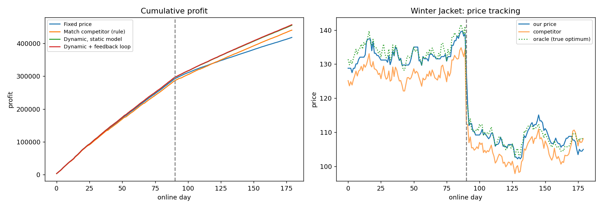

# Dynamic Pricing Engine

A dynamic e-commerce pricing engine. It forecasts demand, picks prices that balance profit and customer satisfaction, and learns from each day's sales through a feedback loop.

Everything is in one Python file, [`dynamic_pricing.py`](dynamic_pricing.py). It simulates a realistic market so the whole pipeline can be trained, run and evaluated from start to finish.



## Features

- **Demand forecasting**: a gradient-boosted Poisson model (scikit-learn `HistGradientBoostingRegressor`) predicts the conversion rate per page view. Monotonic constraints make sure a higher price never predicts higher demand.
- **Rich signals**: price relative to competitors, seasonality (day of week, annual cycle, holidays), customer behaviour (views, cart adds, satisfaction), inventory cover and recent sales.
- **Constrained price optimisation**: for each product it searches a price grid and maximises
  `profit − satisfaction penalty − price-volatility penalty`, subject to:
  - a minimum margin over cost
  - a band around the competitor's price (0.8× to 1.3×)
  - a maximum daily price change (±10%)
  - an inventory cap (stock ÷ days until restock)
- **Feedback loop**: a fast daily bias correction from actual sales (stock-out days are ignored because their sales are censored), plus a full model retrain every 14 days.
- **Evaluation**: forecast MAE/RMSE, revenue and profit uplift over fixed pricing, decision latency, and how many days the engine takes to adapt after a competitor price war.

## Pipeline

```
DATA ──► FORECAST ──► OPTIMISE ──► SELL ──► FEEDBACK
 ▲                                             │
 └─────────────── bias correction / retrain ◄──┘
```

| Stage    | What it does |
|----------|--------------|
| Data     | Historical sales, competitor prices, inventory, customer behaviour and seasonality |
| Forecast | Poisson GBM demand model, with views used as exposure |
| Optimise | Utility-maximising price per product under business constraints |
| Feedback | Daily multiplicative bias correction and periodic full retraining |
| Evaluate | Forecast accuracy, uplift, latency and adaptation speed |

## Getting started

```bash
git clone https://github.com/chandrahzzz/Dynamic-Pricing-Engine.git
cd Dynamic-Pricing-Engine
pip install -r requirements.txt

python dynamic_pricing.py                 # one simulated market
python dynamic_pricing.py --seeds 5       # average uplift over 5 random markets
python dynamic_pricing.py --plot          # also save dynamic_pricing_results.png
```

| Option          | Default | Description |
|-----------------|---------|-------------|
| `--seeds`       | 1       | Number of random markets to evaluate |
| `--hist-days`   | 730     | Days of simulated history used for training |
| `--online-days` | 180     | Days of live pricing to simulate |
| `--plot`        | off     | Save cumulative profit and price-tracking charts |

Requires Python 3.9+ and numpy, pandas and scikit-learn. matplotlib is only needed for `--plot`.

## Sample results

From a run with seed 0: 2 years of history, 180 live days, and a 15% competitor price cut on live day 90.

**Demand forecast (hold-out, units per product per day)**

| Model             | MAE  | RMSE |
|-------------------|------|------|
| GBM demand model  | 1.29 | 1.90 |
| 7-day moving avg  | 3.34 | 4.84 |
| Yesterday's sales | 3.91 | 5.96 |

**Live pricing compared with fixed prices**

| Policy                   | Revenue uplift | Profit uplift | Avg satisfaction | Stock-out rate |
|--------------------------|---------------:|--------------:|-----------------:|---------------:|
| Fixed price              | 0.00%          | 0.00%         | 0.66             | 0.02           |
| Match competitor (rule)  | +12.15%        | +5.28%        | 0.99             | 0.06           |
| Dynamic, static model    | +13.74%        | +8.86%        | 0.98             | 0.03           |
| **Dynamic + feedback loop** | **+13.76%** | **+9.28%**    | **0.98**         | **0.02**       |

**Responsiveness**: about 23 ms per pricing decision for the whole catalogue. After the competitor price war, the engine reaches the true optimal price within about 1 day.

## Using real data

The simulated `MarketData` and `Store` classes stand in for a real data feed. To use your own data, provide a DataFrame with these columns:

```
date, product_id, price, comp_price, views, cart_adds,
inventory, satisfaction, lag1, roll7, units
```

Then call `fit_demand_model(df)` and price with `DynamicPricer`. Business rules such as margins, competitor band, maximum daily change and retrain cadence are set in the `Config` dataclass.

## Project structure

```
├── dynamic_pricing.py   # full engine: data, forecasting, optimisation, feedback, evaluation
├── requirements.txt
└── assets/
    └── dynamic_pricing_results.png
```

## Author

**Chandrahas Reddy**: [@chandrahzzz](https://github.com/chandrahzzz)
